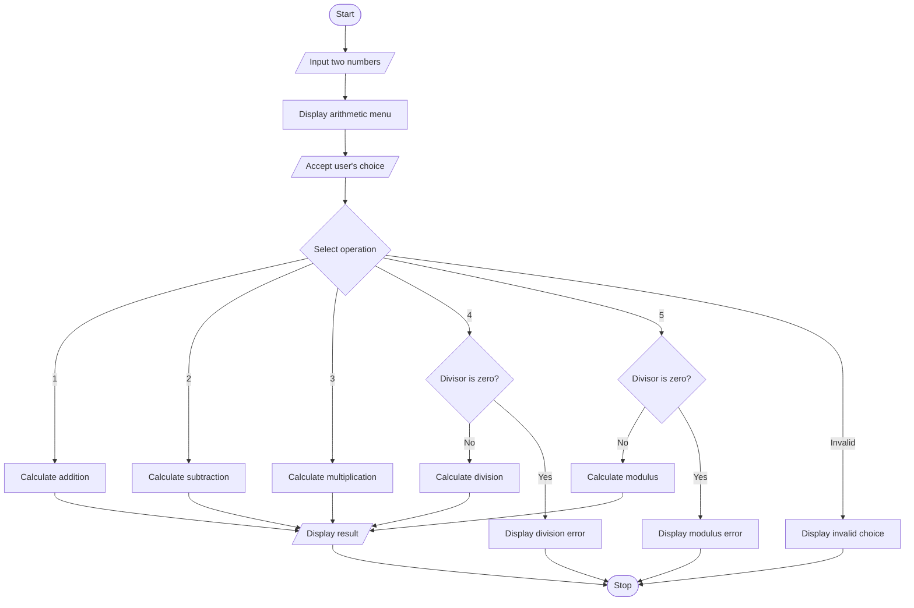

# Menu-Driven-Program-in-C-to-implement-Arithmetic-Operations

# Assignment 3: Menu-Driven Arithmetic Operations in C

## 1. Problem Statement

Write a menu-driven program in C to implement the basic arithmetic operations, including addition, subtraction, multiplication, division, and modulus, using the `switch-case` control structure.

## 2. Objectives

- To learn and understand arithmetic operators in C.
- To understand logical and relational operators.
- To learn and implement the `switch-case` control structure.
- To develop a menu-driven program for performing basic arithmetic calculations.
- To understand the use of `break` and `default` statements in C.

## 3. Theory

### What are Arithmetic Operators?

Arithmetic operators are used to perform mathematical calculations on numeric values in C.

| Operator | Operation | Example |
|---|---|---|
| `+` | Addition | `20 + 4 = 24` |
| `-` | Subtraction | `20 - 4 = 16` |
| `*` | Multiplication | `20 * 4 = 80` |
| `/` | Division | `20 / 4 = 5` |
| `%` | Modulus | `20 % 4 = 0` |

The modulus operator returns the remainder after integer division and is used with integer operands.

### What are Logical Operators?

Logical operators are used to combine or reverse conditions. They return `1` for true and `0` for false.

| Operator | Description | Example |
|---|---|---|
| `&&` | Logical AND | `(a > 0 && b > 0)` |
| `||` | Logical OR | `(a > 0 || b > 0)` |
| `!` | Logical NOT | `!(a > 0)` |

### What are Relational Operators?

Relational operators compare two values and return `1` if the specified condition is true or `0` otherwise.

| Operator | Description |
|---|---|
| `==` | Equal to |
| `!=` | Not equal to |
| `>` | Greater than |
| `<` | Less than |
| `>=` | Greater than or equal to |
| `<=` | Less than or equal to |

### What is a Switch-Case Statement?

The `switch-case` statement is a selection control structure in C that allows a program to execute different blocks of code depending on the value of an expression.

**Syntax:**

```c
switch (expression) {
    case constant1:
        // Statements
        break;

    case constant2:
        // Statements
        break;

    default:
        // Statements for invalid choices
}
```

- `switch`: Evaluates the expression.
- `case`: Specifies a possible value of the expression.
- `break`: Terminates the switch block and prevents fall-through.
- `default`: Executes when no case matches the expression.

### What is a Menu-Driven Program?

A menu-driven program displays a list of operations and allows the user to select one. In C, the `switch-case` statement can be used to select an operation, while loops can be used to repeat the menu until the user chooses to exit.

## 4. Algorithm

1. Start the program.
2. Declare variables to store two numbers, the user's choice, and the result.
3. Accept two numbers from the user.
4. Display the menu containing the arithmetic operations.
5. Accept the user's choice.
6. Use a `switch-case` statement to select the required operation.
7. Perform the selected arithmetic operation.
8. Check whether the divisor is zero before performing division or modulus.
9. Display the calculated result or an appropriate error message.
10. If the user enters an invalid choice, display an error message.
11. Stop the program.

## 5. C Program

```c
#include <stdio.h>

int main() {
    int num1, num2, choice;

    printf("Enter the first number: ");
    scanf("%d", &num1);

    printf("Enter the second number: ");
    scanf("%d", &num2);

    printf("\n--- ARITHMETIC OPERATIONS MENU ---\n");
    printf("1. Addition\n");
    printf("2. Subtraction\n");
    printf("3. Multiplication\n");
    printf("4. Division\n");
    printf("5. Modulus\n");
    printf("Enter your choice: ");
    scanf("%d", &choice);

    switch (choice) {
        case 1:
            printf("Addition = %d\n", num1 + num2);
            break;

        case 2:
            printf("Subtraction = %d\n", num1 - num2);
            break;

        case 3:
            printf("Multiplication = %d\n", num1 * num2);
            break;

        case 4:
            if (num2 != 0) {
                printf("Division = %d\n", num1 / num2);
            } else {
                printf("Error: Division by zero is not allowed.\n");
            }
            break;

        case 5:
            if (num2 != 0) {
                printf("Modulus = %d\n", num1 % num2);
            } else {
                printf("Error: Modulus by zero is not allowed.\n");
            }
            break;

        default:
            printf("Invalid choice. Try again.\n");
    }

    return 0;
}
```

**Note:** This program uses integer arithmetic. Therefore, integer division discards the fractional part. For example, `7 / 2` produces `3`. To obtain decimal results, use `float` or `double` variables and the appropriate format specifiers.

## 6. Sample Input and Output

### Operation 1: Addition

**Input:**

```text
Enter the first number: 20
Enter the second number: 4

--- ARITHMETIC OPERATIONS MENU ---
1. Addition
2. Subtraction
3. Multiplication
4. Division
5. Modulus
Enter your choice: 1
```

**Output:**

```text
Addition = 24
```

### Operation 2: Subtraction

**Input:**

```text
Enter the first number: 20
Enter the second number: 4
Enter your choice: 2
```

**Output:**

```text
Subtraction = 16
```

### Operation 3: Multiplication

**Input:**

```text
Enter the first number: 20
Enter the second number: 4
Enter your choice: 3
```

**Output:**

```text
Multiplication = 80
```

### Operation 4: Division

**Input:**

```text
Enter the first number: 20
Enter the second number: 4
Enter your choice: 4
```

**Output:**

```text
Division = 5
```

### Operation 5: Modulus

**Input:**

```text
Enter the first number: 20
Enter the second number: 4
Enter your choice: 5
```

**Output:**

```text
Modulus = 0
```

### Invalid Choice

**Input:**

```text
Enter the first number: 20
Enter the second number: 4
Enter your choice: 8
```

**Output:**

```text
Invalid choice. Try again.
```

## 7. Flowchart



## 8. FAQs

### Q1. What is a `break` statement?

The `break` statement terminates the nearest enclosing loop or `switch` statement. In a `switch-case` structure, it prevents execution from falling through into the subsequent cases.

### Q2. What happens if all `break` statements are removed from a switch-case structure?

If the `break` statements are removed, execution continues into the statements of subsequent cases after a matching case is found. This is called fall-through and may result in multiple operations being executed unintentionally.

### Q3. Why is the `default` case used?

The `default` case executes when the value of the switch expression does not match any of the specified cases. It is commonly used to display an error message when the user enters an invalid menu choice.

## 9. Conclusion

Thus, a menu-driven arithmetic calculator was implemented successfully in C using the `switch-case` control structure. This experiment helped develop an understanding of arithmetic, logical, and relational operators, along with the use of `break` and `default` statements for controlling program execution.
